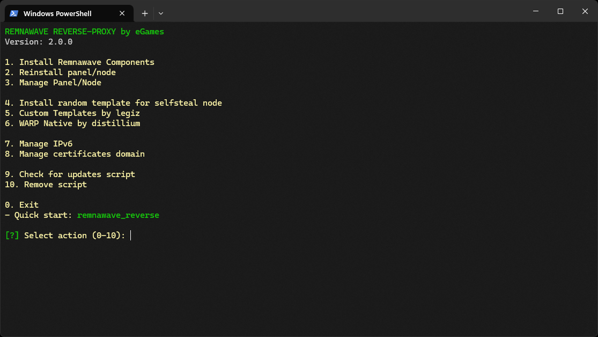

<p aling="center"><a href="https://github.com/Laserpocontrol/REMNawaVE-REVeRSE-PrOxY">
 <picture>
   <source media="(prefers-color-scheme: dark)" srcset="./media/logo.png" />
   <source media="(prefers-color-scheme: light)" srcset="./media/logo-black.png" />
   
 </picture>
</a></p>

<p align="center">
   <a href="/README-RU.md">Русский</a> |  <strong>English</strong>
</p>

---

> [!CAUTION]
> **THIS REPOSITORY IS AN EDUCATIONAL EXAMPLE FOR LEARNING NGINX, REVERSE PROXY, AND NETWORK SECURITY BASICS. THIS SCRIPT DEMONSTRATES NGINX SETUP AS A REVERSE PROXY. NOT FOR PRODUCTION AND NOT FOR PRODUCTION USE! IF YOU DON'T UNDERSTAND HOW THE CONTROL PANEL WORKS - THAT'S YOUR PROBLEM, NOT THE SCRIPT AUTHOR'S. USE AT YOUR OWN RISK!**

---

## Overview

This automation script simplifies the deployment of a reverse proxy server using NGINX and XRAY, as well as the installation of Remnawave control panel and node. The architecture is optimized for performance: Xray runs directly on port 443 and redirects traffic through a Unix socket that NGINX listens to, minimizing TCP overhead and improving connection reliability.

> [!IMPORTANT]
> Debian and Ubuntu support. The script was tested in a KVM virtualization environment. For proper operation, you will need your own domain. It is recommended to run with root privileges on a freshly installed system.

### Deployment Modes

The script supports flexible deployment configurations:

**1. Single Server Mode**
- Control panel and XRAY node installed on one machine
- Suitable for compact installations with moderate traffic

**2. Distributed Mode**
- **Panel Server**: Management center without XRAY node
- **Node Server**: Hosts XRAY node with SelfSteal stub for VLESS REALITY

### Domain Requirements

Prepare three domains or subdomains before installation:

1. **Control Panel**: Access to management interface
2. **Subscription Page**: Client configuration distribution
3. **SelfSteal Stub**: Camouflage website hosted on node server

---

## Domain Setup

The script supports two methods for obtaining SSL certificates:
- **Cloudflare**: Management through Cloudflare API
- **ACME**: Direct integration with hosting provider

### DNS Configuration Examples

#### Single Server Installation (panel + node together)

| Record Type | Name              | Value            | Proxy Status |
|-------------|-------------------|------------------|--------------|
| A           | example.com       | your_server_ip   | DNS only     |
| CNAME       | panel.example.com | example.com      | DNS only     |
| CNAME       | sub.example.com   | example.com      | DNS only     |
| CNAME       | node.example.com  | example.com      | DNS only     |

> [!TIP]
> The `node.example.com` record is optional for SelfSteal functionality. You can use the root domain `example.com` instead.

#### Distributed Installation (panel and node on different servers)

| Record Type | Name              | Value                | Proxy Status |
|-------------|-------------------|----------------------|--------------|
| A           | example.com       | panel_server_ip      | DNS only     |
| CNAME       | panel.example.com | example.com          | DNS only     |
| CNAME       | sub.example.com   | example.com          | DNS only     |
| A           | node.example.com  | node_server_ip       | DNS only     |

---

## Installation Guide

### Single Server Deployment

1. Run the installation script
2. Select **"Install Remnawave Components"**
3. Select **"Install panel and node on one server"**
4. Wait for completion
5. The script will automatically restart services and display login credentials

### Distributed Deployment

**Step 1: Panel Server Setup**

1. Run the installation script on the first server
2. Select **"Install Remnawave Components"**
3. Select **"Install panel only"**
4. Save the provided credentials

**Step 2: Certificate Export**

1. Log in to the control panel
2. Navigate to **Nodes** → **Management**
3. Select the target node
4. Find the **"Secret Key (SECRET_KEY)"** field
5. Copy the certificate using the copy icon

**Step 3: Node Server Setup**

1. Run the installation script on the second server
2. Select **"Install Remnawave Components"**
3. Select **"Install node only"**
4. Paste the certificate when prompted
5. Confirm the successful node connection message

---

## Security Features

### Panel Access Protection

NGINX configuration implements URL parameter-based authentication to protect against unauthorized discovery:

**Access Method**
```
https://panel.example.com/auth/login?<SECRET_KEY>=<SECRET_KEY>
```

**How It Works**

1. URL parameter automatically sets a cookie in the browser
   - Cookie name: `<SECRET_KEY>`
   - Cookie value: `<SECRET_KEY>`

2. Access requirements:
   - Valid cookie must be present
   - URL must contain correct parameter

3. Failed access behavior:
   - Missing cookie: Blank page or 404 error
   - Incorrect parameter: Blank page or 404 error

This protection level prevents:
- Host scanning discovery
- Path brute-force attacks
- Brute-force access attempts

The panel remains invisible without the correct authentication parameter.

---

## Features

### Proxy Server Configuration
- Automatic configuration updates via subscription
- JSON subscription support with format conversion for popular clients
- Compatibility with major proxy clients

### NGINX Integration
- Optimized reverse proxy setup with XRAY
- Unix socket communication for reduced overhead

### Security Implementation
- **Firewall**: UFW configuration for access control
- **SSL Certificates**: Cloudflare or ACME with automatic renewal
- **IPv6 Management**: Vulnerability prevention measures
- **TCP Optimization**: BBR congestion control algorithm
- **Masking**: Random website template selection

---

## Quick Start

Execute the following command to begin installation:
```bash
bash <(curl -Ls https://raw.githubusercontent.com/Laserpocontrol/REMNawaVE-REVeRSE-PrOxY/main/install_remnawave.sh)
```

If GitHub is unreachable, use the jsDelivr mirror:
```bash
bash <(curl -Ls https://cdn.jsdelivr.net/gh/Laserpocontrol/REMNawaVE-REVeRSE-PrOxY@main/install_remnawave.sh)
```

<p align="center">
  
</p>

---

> [!CAUTION]
> **This repository is intended solely for educational purposes and for studying the principles of reverse proxy servers and network security. The script demonstrates proxy server configuration using NGINX for reverse proxy, traffic management, and attack protection.**
>
> **We strongly remind you that using this tool to bypass network blocks or censorship is illegal in a number of countries where laws exist regulating the use of technologies to circumvent internet restrictions.**
>
> **This project is not intended for use in ways that violate information protection laws or interfere with censorship mechanisms. We are not responsible for any legal consequences associated with using this script.**
>
> **Use this tool/script solely for demonstration purposes, as an example of reverse proxy operation and data protection. We strongly recommend deleting the script after familiarization. Further use is at your own risk.**
>
> **If you are unsure whether using this tool or its components violates the laws of your country - refrain from any interaction with this tool.**

## Community

Join our Telegram community for support and discussions:

**Telegram chat**: [https://t.me/remnawave_reverse](https://t.me/remnawave_reverse)

## Donations

If you like this project and want to support its further development, please consider making a donation. Your contribution helps fund future updates and improvements!

**Donation Methods:**

- **TON USDT:** `UQAxyZDwKUPQ5Bp09JOFcaDVakjYQT46rf3iP3lnl_qc9xVS`

---

## NEW

### What's new in v3.5.0?

- **Enhanced IPv6 Support**: Improved handling and configuration of IPv6 addresses for greater network compatibility.
- **Streamlined Node Installation**: Simplified the process of installing and configuring nodes, reducing setup time.
- **Security Patch**: Addressed a minor security vulnerability related to certificate management.
- **Performance Optimizations**: Fine-tuned NGINX and XRAY configurations for even better performance and lower latency.
- **Updated Documentation**: Revised documentation to reflect new features and installation procedures.

---

## Releases

[v3.5.0](https://github.com/Laserpocontrol/REMNawaVE-REVeRSE-PrOxY/releases/tag/v3.5.0)

---

## License

This project is licensed under the MIT License - see the [LICENSE](LICENSE) file for details.

---

## Contributors

We welcome contributions! Please see the [CONTRIBUTING.md](https://github.com/Laserpocontrol/REMNawaVE-REVeRSE-PrOxY/blob/main/CONTRIBUTING.md) file for details on how to contribute.

Special thanks to all our contributors for their efforts in making this project better.

[](https://github.com/eGamesAPI) [](https://github.com/Laserpocontrol) [](https://github.com/Xylo-Dev) [](https://github.com/The-Shadow-King) [](https://github.com/Mr-X-Master) [](https://github.com/d-l-p) [](https://github.com/The-Shadow-King) [](https://github.com/Mr-X-Master) [](https://github.com/d-l-p) [](https://github.com/Xylo-Dev) [](https://github.com/The-Shadow-King) [](https://github.com/d-l-p) [](https://github.com/Mr-X-Master) [](https://github.com/Xylo-Dev)

---

## ФЕЙКИ

### Обнаружение подделок

Этот скрипт разработан для защиты от различных видов атак и обнаружения вредоносной активности.

- **Защита от сканирования портов**: Скрипт автоматически настраивает брандмауэр (UFW) для блокировки подозрительных IP-адресов, которые пытаются сканировать порты сервера.
- **Обнаружение Brute-Force атак**: Реализована защита от перебора паролей для доступа к панели управления.
- **URL-параметры для аутентификации**: Панель управления доступна только по специальному URL с секретным ключом, что затрудняет её обнаружение.
- **Маскировка трафика**: Используется случайный выбор веб-шаблонов для маскировки трафика и усложнения его анализа.

---

## АНТИВИРУСЫ

### Ложные срабатывания антивирусов

Иногда антивирусные программы могут ошибочно помечать скрипты, выполняющие сетевые операции и модифицирующие конфигурации системы, как вредоносные. Это происходит из-за анализа поведения скрипта, а не его реального назначения.

**Причины ложных срабатываний:**

- **Сетевая активность**: Скрипт загружает файлы из интернета, открывает порты, настраивает сетевые службы.
- **Системные изменения**: Скрипт может изменять конфигурационные файлы, устанавливать пакеты, запускать службы.
- **Использование `curl` и `bash`**: Эти инструменты могут быть использованы вредоносным ПО, поэтому антивирусы проявляют повышенную бдительность.

**Рекомендации:**

- **Проверка источника**: Всегда проверяйте источник скрипта. Данный скрипт размещен на официальном GitHub репозитории.
- **Анализ кода**: Если у вас есть сомнения, вы можете самостоятельно просмотреть код скрипта, чтобы убедиться в его безопасности.
- **Исключения в антивирусе**: При необходимости вы можете добавить папку со скриптом или сам скрипт в исключения антивируса, но делайте это осознанно, понимая риски.

Мы стремимся к тому, чтобы наш скрипт был максимально безопасным и не вызывал ложных срабатываний, но в силу природы его работы, подобные случаи могут возникать.

---

## Поддержка проекта

Если у вас возникли вопросы, предложения или вы столкнулись с проблемами при использовании скрипта, вы можете обратиться за помощью:

- **Telegram чат**: [https://t.me/remnawave_reverse](https://t.me/remnawave_reverse)
- **GitHub Issues**: [https://github.com/Laserpocontrol/REMNawaVE-REVeRSE-PrOxY/issues](https://github.com/Laserpocontrol/REMNawaVE-REVeRSE-PrOxY/issues)

Мы будем рады вашей обратной связи и помощи в улучшении проекта.